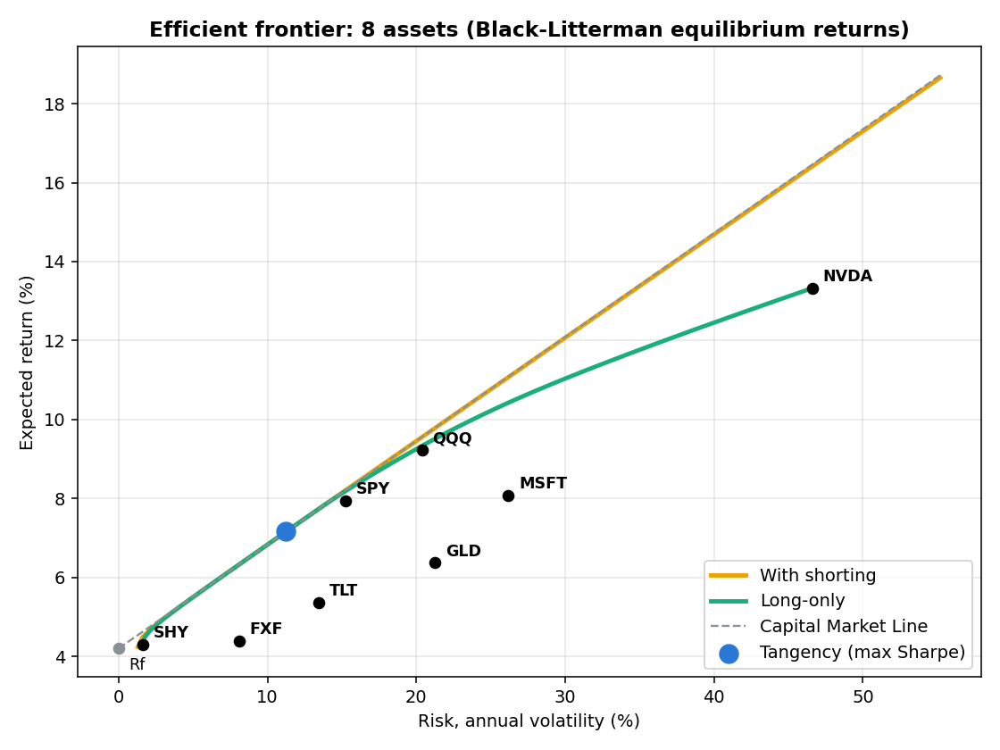
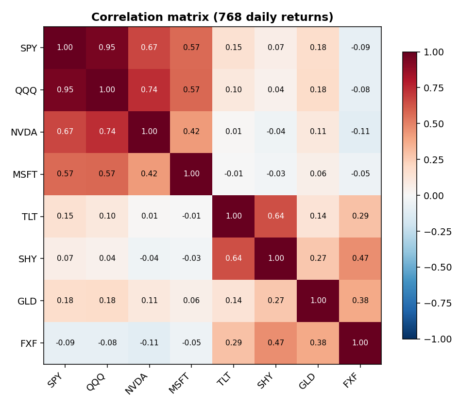
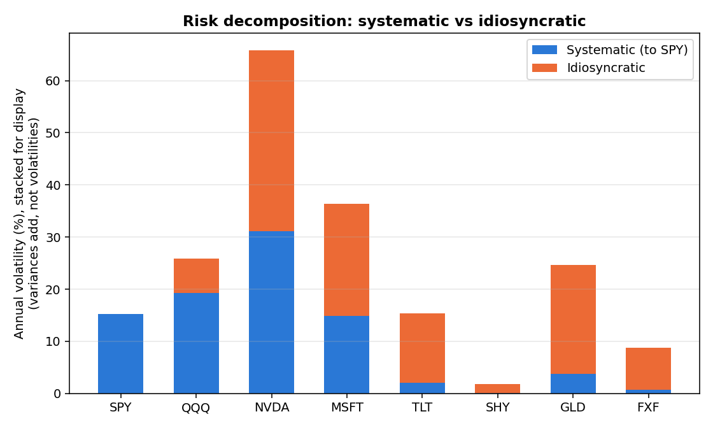
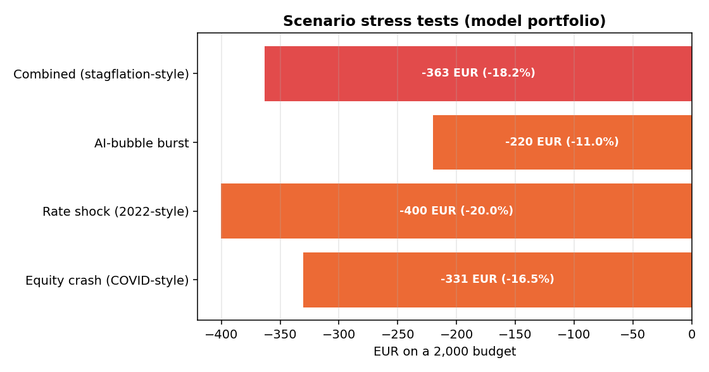
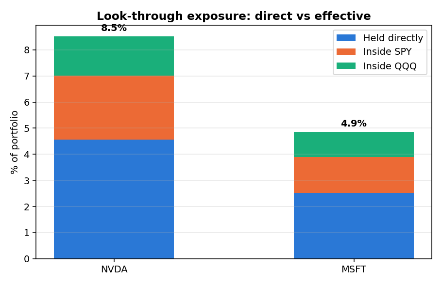

# Risk analysis of an assumed 8-asset allocation

A Python pipeline that takes a small, **assumed** allocation of eight ETFs and stocks through the
standard portfolio-management toolkit: risk decomposition, a Fama-French 5-factor check, CAPM, the
mean-variance efficient frontier, Black-Litterman, VaR / CVaR, stress tests, look-through exposure and
an out-of-sample check.

I built it to learn portfolio management by doing: read the theory first, then implement it on a
portfolio I plan to run with my own money (a €2,000 model portfolio). The weights are an assumption, not
the output of an optimizer, so this is a **risk analysis of a chosen allocation**, not a strategy search.
Educational project, not investment advice.

> **About this code.** The original scripts from September 2026 were lost; only the results
> (charts and a published write-up) survived. This repository is a **reconstruction** written from
> that description, with AI assistance. To check that it is faithful, it is tested against the numbers
> I published: **16 of 16 reference values are reproduced within tolerance**.
> The stress-test shocks were not recorded, so they were re-specified from scratch and do **not**
> match the original results. A full PDF report is in [`docs/`](docs/Portfolio_Research_Report_v2.pdf).

## Universe and parameters

`SPY, QQQ, NVDA, MSFT, TLT, SHY, GLD, FXF`. Daily adjusted prices from yfinance, 2023-09-05 to
2026-09-25 (768 daily returns). NVDA and MSFT are deliberately arbitrary picks: I did no fundamental or macro
analysis to choose them.

Everything below is an input you can change in [`config.py`](portfolio_lab/config.py):

| Parameter | Value | Where it comes from |
|---|---|---|
| Risk-free rate | 4.2% | assumption, taken from the original write-up |
| Equity risk premium (ERP) | 4.29% | backed out from the published CAPM figures; the original used Damodaran's implied ERP |
| Risk aversion δ | 2.345 | calibrated: (wᵀβ · ERP) / (wᵀΣw), not picked from a textbook range |
| Budget | €2,000 | the model portfolio |
| Asset-class allocation | equities 55 / long bonds 15 / short bonds 15 / gold 10 / CHF 5 (%) | assumption |
| NVDA, MSFT share of the S&P 500 | 8.3%, 4.6% | September 2026 |
| SPY : QQQ split of the rest of equities | 62 : 38 | derived from the published tangency weights (AUM figures were not kept) |
| NVDA, MSFT share of QQQ | 8.15%, 5.31% | [Trackinsight](https://www.trackinsight.com/en/fund/QQQ/holdings), 2026-05-31; weights drift with prices |

Resulting weights: SPY 29.6%, QQQ 18.3%, NVDA 4.6%, MSFT 2.5%, TLT 15%, SHY 15%, GLD 10%, FXF 5%.

## Pipeline

| Step | Module | What it does |
|---|---|---|
| 1 | `risk.py` | Volatility, 8×8 correlations, beta to SPY, systematic vs idiosyncratic variance |
| 2 | `factors.py` | Fama-French 5-factor regression (factors estimated jointly) as a cross-check on CAPM |
| 3 | `capm.py` | Expected returns from beta and a forward-looking equity risk premium |
| 4 | `frontier.py` | Efficient frontier (long-only and with shorting), tangency and minimum-variance portfolios |
| 5 | `black_litterman.py` | Reverse optimization of market-implied returns, π = δΣw |
| 6 | `var.py` | VaR and CVaR: Historical, Parametric (normal), Monte Carlo (bootstrap of real days) |
| 7 | `stress.py` | Four scenario shocks applied to the portfolio |
| 8 | `lookthrough.py` | Effective NVDA / MSFT exposure including what SPY and QQQ hold |
| 9 | `benchmark.py` | Comparison with SPY, hold-out check of VaR, stability of the NVDA alpha |

## Results (window 2023-09-05 to 2026-09-25)

- **NVDA beta 2.04**, SHY about 0.01. NVDA's idiosyncratic volatility (34.6%) alone exceeds the whole volatility of QQQ (20.4%).
- **Fama-French 5 factors:** NVDA shows about **32% a year of unexplained alpha** over the whole window, but it is **not stable**: 43% on the first two years and 15% on the last year (see below). Treat it as a feature of the AI rally, not a property of the stock.
- **Black-Litterman trap:** weighting by market cap inside a narrow universe gave NVDA about 50% weight and a ~90% implied return. Units are not comparable and SPY / QQQ already contain NVDA and MSFT. Rebuilding the weights from a macro allocation and NVDA's real S&P 500 share gives **13.3%**, in line with CAPM (13.0%).
- **Tangency portfolio (long-only):** expected return 7.16%, volatility 11.25%, Sharpe 0.26. On Black-Litterman returns it equals the assumed weights by construction, so it is a consistency check, not an independent view.
- **VaR / CVaR (1 day, €2,000):** Historical and bootstrap agree; Parametric understates the 99% CVaR by about 21% (€36.40 vs €46.19), an effect of fat tails.



| | | |
|---|---|---|
|  |  |  |
|  |  |  |

### Look-through exposure

SPY and QQQ already hold NVDA and MSFT, so the direct weights understate the real concentration.

| | Held directly | Inside SPY | Inside QQQ | **Effective** |
|---|---|---|---|---|
| NVDA | 4.6% | 2.5% | 1.5% | **8.5%** |
| MSFT | 2.5% | 1.4% | 1.0% | **4.9%** |

NVDA's effective weight is about **1.9 times** the direct one. With the October 2025 QQQ weights (NVDA 9.9%, MSFT 8.3%) it would be 8.8% and 5.4%.

### Out-of-sample check

The weights are assumed, so there is no strategy to overfit. What can be tested is whether risk estimates made on the
**first two years** (2023-09 to 2025-09) hold on the **last year** (251 days from 2025-09-26):

| VaR fitted on train | 95%: breaches (expected 5%) | 99%: breaches (expected 1%) |
|---|---|---|
| Historical | 6.0% | 0.4% |
| Parametric | 5.2% | 0.8% |
| Monte Carlo (bootstrap) | 6.0% | 0.4% |

The estimates hold up: breach rates are close to the nominal levels (one year is a small sample, 99% means 2.5 expected breaches).

Model portfolio against SPY (constant weights, risk-free rate 4.2%):

| | CAGR | Volatility | Sharpe | Max drawdown |
|---|---|---|---|---|
| Full window: portfolio | 17.9% | 11.2% | 1.15 | −11.2% |
| Full window: SPY | 20.8% | 15.2% | 1.04 | −18.8% |
| Hold-out year: portfolio | 12.5% | 10.9% | 0.75 | −7.9% |
| Hold-out year: SPY | 18.6% | 13.0% | 1.05 | −8.9% |

The portfolio is calmer than SPY, but over the last year it lagged on return and Sharpe. It was not built to beat SPY.

The NVDA alpha is clearly unstable:

| | NVDA FF5 alpha (annual) | R² | Observations |
|---|---|---|---|
| First two years | 43.0% | 60.5% | 517 |
| Last year (to 2026-08-31) | 14.9% | 56.3% | 233 |

### Stress scenarios

Shocks are the assumed instant price changes below. They are loosely based on COVID-2020, 2022 and an AI-bubble
sketch, were **not tuned** to any target, and say nothing about the probability of a scenario.

| Shock | SPY | QQQ | NVDA | MSFT | TLT | SHY | GLD | FXF | Portfolio |
|---|---|---|---|---|---|---|---|---|---|
| Equity crash (COVID-style) | −34% | −28% | −38% | −28% | +8% | +1% | −3% | +1% | −16.5% (−€331) |
| Rate shock (2022-style) | −19% | −33% | −50% | −28% | −31% | −4% | −1% | 0% | −20.0% (−€400) |
| AI-bubble burst | −15% | −25% | −60% | −30% | +5% | +1% | +5% | +2% | −11.0% (−€220) |
| Combined (stagflation-style) | −25% | −30% | −45% | −30% | −20% | −3% | +10% | 0% | −18.2% (−€363) |

The worst case here is the rate shock: bonds, the usual hedge, fall with equities. (The original, unrecoverable shocks
gave −14.6%, −11.2%, −9.0% and −15.6%; the ranking of scenarios differs, which is one more reason to treat
stress numbers as assumptions.)

## Reproduction check

`python -m portfolio_lab --fixed` prints this table and the test suite asserts it.

| Metric | Published | Reproduced |
|---|---|---|
| NVDA beta | 2.044 | 2.044 |
| NVDA volatility, % | 46.59 | 46.59 |
| NVDA idiosyncratic vol, % | 34.6 | 34.63 |
| NVDA FF5 alpha, % p.a. | 31.97 | 31.98 |
| NVDA FF5 R², % | 56.5 | 56.53 |
| δ (risk aversion) | 2.345 | 2.339 |
| CAPM NVDA, % | 12.98 | 12.97 |
| BL implied return NVDA, % | 13.34 | 13.33 |
| BL implied return SPY, % | 7.95 | 7.95 |
| Tangency E[R], % | 7.16 | 7.16 |
| Tangency volatility, % | 11.25 | 11.25 |
| Tangency Sharpe | 0.264 | 0.263 |
| Historical 95% VaR, € | 21.33 | 21.33 |
| Historical 99% CVaR, € | 46.19 | 46.20 |
| Parametric 99% CVaR, € | 36.40 | 36.40 |
| Monte Carlo 99% CVaR, € | 46.17 | 45.97 |

Tolerances are defined in [`SPEC.md`](SPEC.md). The out-of-sample, look-through and benchmark blocks are new
in v2 and have no published counterpart.

## Limitations

- **The weights are an assumption.** Black-Litterman is run without personal views, so the optimizer confirms
  the allocation rather than discovering it. Adding views (P, Q, Ω) is future work.
- Three years of data and one regime dominated by the AI rally; the hold-out is a single year.
- The QQQ look-through weights are a dated public estimate, not a live feed.
- Stress shocks are assumptions; the original shocks were not recorded.
- No transaction costs, taxes or position constraints. Shorting is shown for the frontier only; on a retail budget
  it is usually impractical (margin, borrow fees, unlimited loss).
- Fama-French data are published with a lag, so the factor regression window is capped at 2026-08-31 (750 observations).
- Run on a rolling window by default, so numbers drift from the tables above; use `--fixed` to reproduce them.

## Run it

```bash
pip install -r requirements.txt
python -m pytest -q                  # 37 tests, reference values asserted
python -m portfolio_lab --fixed      # reproduces the published numbers + 8 charts
python -m portfolio_lab              # same pipeline on the latest 3 years
```

No API keys needed: prices come from yfinance, factors from the Ken French Data Library.
Downloaded data is cached in `data/cache/`.

## Sources

yfinance (prices), Ken French Data Library (factors), Damodaran (implied equity risk premium), Trackinsight (QQQ
holdings). Theory: Markowitz (1952), Sharpe (1964), Fama-French (2015), Black-Litterman (1992).
