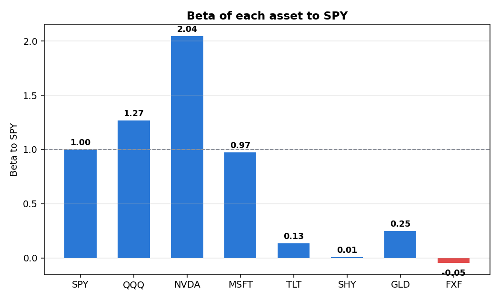
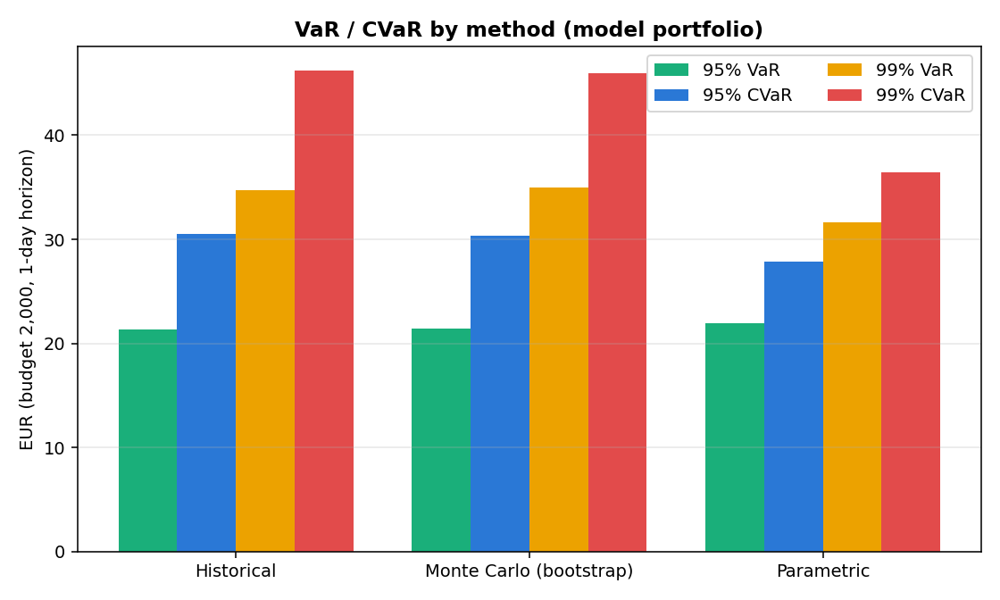

# Portfolio Research: an 8-asset portfolio, end to end

A Python pipeline that takes a small portfolio of eight ETFs and stocks through the standard
portfolio-management toolkit: risk decomposition, a Fama-French 5-factor check, CAPM, the
mean-variance efficient frontier, Black-Litterman, VaR / CVaR and stress tests.

I built it to learn portfolio management by doing: read the theory first, then implement it on a
portfolio I plan to run with my own money (a €2,000 model portfolio). Educational project, not
investment advice.

> **About this code.** The original scripts from September 2026 were lost; only the results
> (charts and a published write-up) survived. This repository is a **reconstruction** written from
> that description, with AI assistance. To make sure it is faithful, it is tested against the numbers
> I published: **16 of 16 reference values are reproduced within tolerance** (table below).
> The stress-test shocks were not recorded, so they were re-specified from scratch and do **not**
> match the original results. Details are in [Assumptions](#assumptions-and-limitations).

## Universe

`SPY, QQQ, NVDA, MSFT, TLT, SHY, GLD, FXF` — US equities, two mega-cap stocks, long and short
Treasuries, gold and the Swiss franc. Three years of daily adjusted prices (yfinance).

NVDA and MSFT are deliberately arbitrary picks: I did no fundamental or macro analysis to choose them.
Comparing them with other tech names is the next step.

## Pipeline

| Step | Module | What it does |
|---|---|---|
| 1 | `risk.py` | Volatility, 8×8 correlation matrix, beta to SPY, split of each asset's variance into systematic and idiosyncratic parts |
| 2 | `factors.py` | Fama-French 5-factor regression (all factors estimated jointly) as a cross-check on CAPM |
| 3 | `capm.py` | Expected returns from beta and a forward-looking equity risk premium |
| 4 | `frontier.py` | Efficient frontier (long-only and with shorting), tangency (max Sharpe) and minimum-variance portfolios |
| 5 | `black_litterman.py` | Reverse optimization of market-implied returns, π = δΣw, with δ calibrated for consistency |
| 6 | `var.py` | VaR and CVaR: Historical, Parametric (normal), Monte Carlo (bootstrap of real days) |
| 7 | `stress.py` | Four scenario shocks applied to the portfolio |

## Results (window 2023-09-05 to 2026-09-25, 768 daily returns)

- **NVDA beta 2.04**, SHY about 0.01. NVDA's idiosyncratic volatility (34.6%) alone exceeds the
  whole volatility of QQQ (20.4%).
- **Fama-French 5 factors:** NVDA still shows about **32% a year of unexplained alpha** (R² 56.5%).
  This is a three-year, in-sample estimate driven by the AI rally. Do not extrapolate it.
- **Black-Litterman trap:** weighting by market cap inside a narrow universe gave NVDA about 50% weight
  and a ~90% implied return. Units are not comparable (a company versus one ETF) and SPY / QQQ already
  contain NVDA and MSFT. Rebuilding the weights from a macro allocation and NVDA's real S&P 500 share gives
  **13.3%**, in line with CAPM (13.0%).
- **Tangency portfolio (long-only):** expected return 7.16%, volatility 11.25%, Sharpe 0.26. On pure
  Black-Litterman returns it equals the market weights by construction, so it is a consistency check,
  not an independent view.
- **VaR / CVaR (1 day, €2,000):** Historical and bootstrap agree; Parametric understates the 99% CVaR
  by about 21% (€36.40 vs €46.19), a direct effect of fat tails. On a one-month horizon the methods
  converge.


| | | |
|---|---|---|
|  |  |  |
|  |  | |

## Reproduction check

`python -m portfolio_lab --fixed` prints this table and the test suite asserts it.

| Metric | Published | Reproduced |
|---|---|---|
| NVDA beta | 2.044 | 2.044 |
| NVDA volatility, % | 46.59 | 46.59 |
| NVDA idiosyncratic vol, % | 34.6 | 34.63 |
| NVDA FF5 alpha, % p.a. | 31.97 | 31.98 |
| NVDA FF5 R², % | 56.5 | 56.53 |
| δ (risk aversion) | 2.345 | 2.339 |
| CAPM NVDA, % | 12.98 | 12.97 |
| BL implied return NVDA, % | 13.34 | 13.33 |
| BL implied return SPY, % | 7.95 | 7.95 |
| Tangency E[R], % | 7.16 | 7.16 |
| Tangency volatility, % | 11.25 | 11.25 |
| Tangency Sharpe | 0.264 | 0.263 |
| Historical 95% VaR, € | 21.33 | 21.33 |
| Historical 99% CVaR, € | 46.19 | 46.20 |
| Parametric 99% CVaR, € | 36.40 | 36.40 |
| Monte Carlo 99% CVaR, € | 46.17 | 45.97 |

Tolerances are defined in [`SPEC.md`](SPEC.md). Small differences come from rounding the published
inputs (risk-free rate, ERP) and from Monte Carlo sampling noise.

## Assumptions and limitations

- **Inputs that are assumptions, not measurements:** risk-free rate 4.2%; equity risk premium 4.29%
  (backed out from the published CAPM figures; the original work used Damodaran's forward-looking implied ERP); macro allocation
  55% equities / 15% long bonds / 15% short bonds / 10% gold / 5% CHF; NVDA and MSFT at 8.3% and 4.6% of the
  equity block. The SPY : QQQ split (62 : 38) was derived from the published tangency weights because
  the original AUM figures were not kept.
- **Stress shocks were re-specified**, loosely based on COVID-2020, 2022 and an AI-bubble sketch (see
  [`stress.py`](portfolio_lab/stress.py)). They were not tuned to the original results, which were
  −14.64%, −11.18%, −8.98% and −15.62%. A stress test says nothing about the probability of a scenario.
- Black-Litterman is run **without personal views**; adding views (P, Q, Ω) is future work.
- Three years of data and one regime dominated by the AI rally. The NVDA alpha is in-sample.
- No transaction costs, taxes or position constraints. Shorting is shown for the frontier only; on a
  retail budget it is usually impractical (margin, borrow fees, unlimited loss).
- Fama-French factors are published with a lag, so the verification window for the factor regression is
  capped at 2026-08-31 (750 observations), as in the original work.
- The package is run on a rolling window by default, so numbers will drift from the table above; use
  `--fixed` to reproduce it.

## Run it

```bash
pip install -r requirements.txt
python -m pytest -q                  # 27 tests, reference values asserted
python -m portfolio_lab --fixed      # reproduces the published numbers + charts
python -m portfolio_lab              # same pipeline on the latest 3 years
```

No API keys needed: prices come from yfinance, factors from the Ken French Data Library.
Downloaded data is cached in `data/cache/`.

## Sources

yfinance (prices), Ken French Data Library (factors), Damodaran (implied equity risk premium).
Theory: Markowitz (1952), Sharpe (1964), Fama-French (2015), Black-Litterman (1992).
